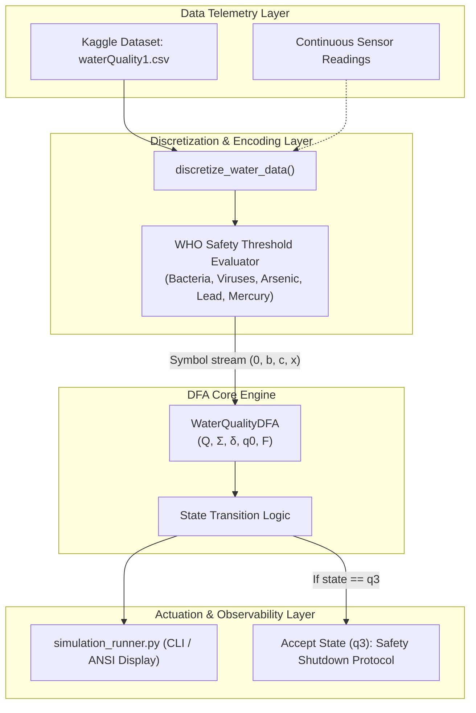
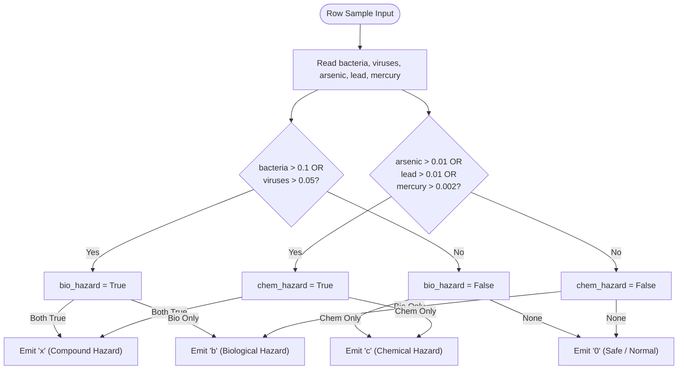
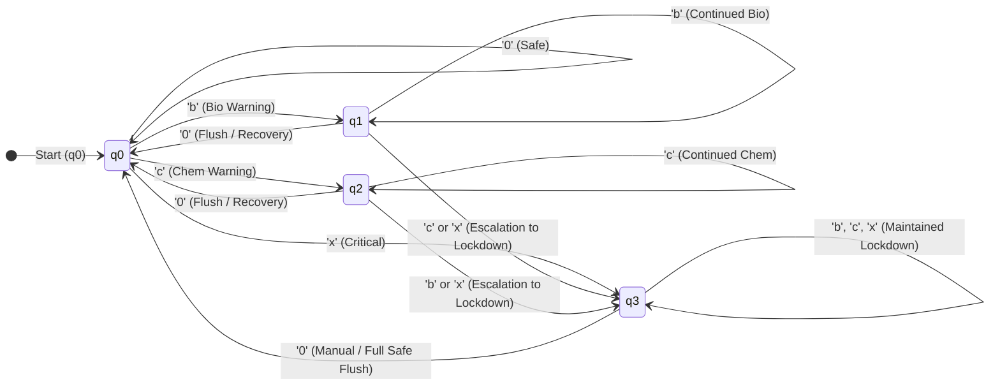

# 🏛️ System Architecture

This document describes the architectural layout, data discretization pipeline, finite state machine design, and software components for the Automated Water Quality Monitoring System.

---

## 1. High-Level Architecture Overview

The system bridges continuous environmental telemetry with formal language processing. It is split into two primary layers:
1. **Perception & Discretization Layer:** Ingests multivariate sensor data, validates against biochemical thresholds, and encodes observations into discrete symbols.
2. **Automaton Engine (Control Layer):** Consumes the encoded sequence, executes deterministic state transitions, and enforces escalation/safety protocols.

---

## 2. Discretization Engine Pipeline

The discretization component (`discretize_water_data`) reads continuous floating-point measurements and evaluates them according to safety rules:

---

## 3. Finite Automata State Transition Graph

The deterministic finite automaton operates on alphabet $\Sigma = \{0, b, c, x\}$ across states $Q = \{q_0, q_1, q_2, q_3\}$.

---

## 4. Software Component Design

### 4.1 `WaterQualityDFA` ([`water_quality_automaton.py`](file:///c:/Users/sanja/Desktop/Sanjay/ProCoded/FLA/water_quality_automaton.py))
- **`states`:** Python set containing $\{'q0', 'q1', 'q2', 'q3'\}$.
- **`alphabet`:** Set of permissible input tokens $\{'0', 'b', 'c', 'x'\}$.
- **`start_state`:** `'q0'`.
- **`accept_states`:** $\{'q3'\}$.
- **`transitions`:** Nested dictionary mapping $(q, \sigma) \to q'$ ensuring $O(1)$ constant time transition evaluations.
- **Methods:**
  - `reset()`: Resets `current_state` to `start_state`.
  - `process_symbol(symbol)`: Validates symbol against alphabet, executes transition, returns `(prev_state, new_state)`.
  - `process_string(input_string)`: Evaluates a sequence of symbols and checks acceptance.

### 4.2 `simulation_runner.py` ([`simulation_runner.py`](file:///c:/Users/sanja/Desktop/Sanjay/ProCoded/FLA/simulation_runner.py))
- **Terminal Presentation Layer:** Uses ANSI escape sequences to provide visual feedback for state transitions (`Safe`: Green, `Warning`: Yellow, `Lockdown`: Red).
- **Time Delay Simulation:** Integrates non-blocking artificial delays via `time.sleep` to mimic real-world IoT sensor sampling intervals.
- **Dataset Integration:** Seamlessly chains continuous CSV discretization into the discrete FSM engine.
