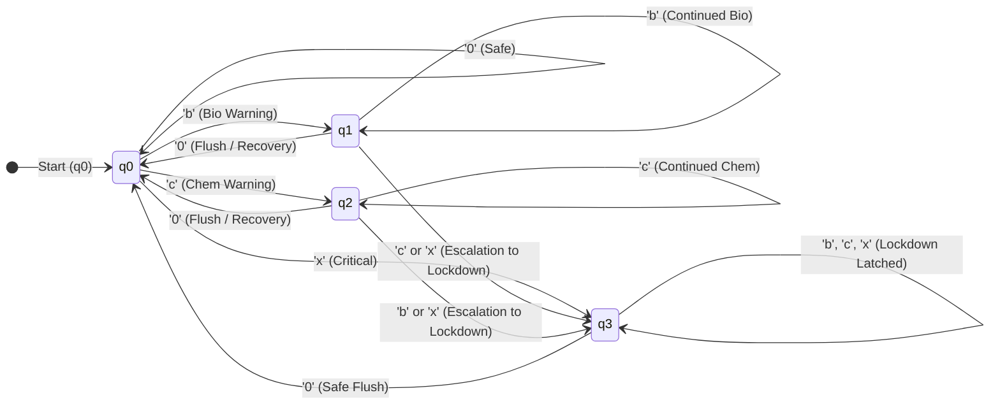
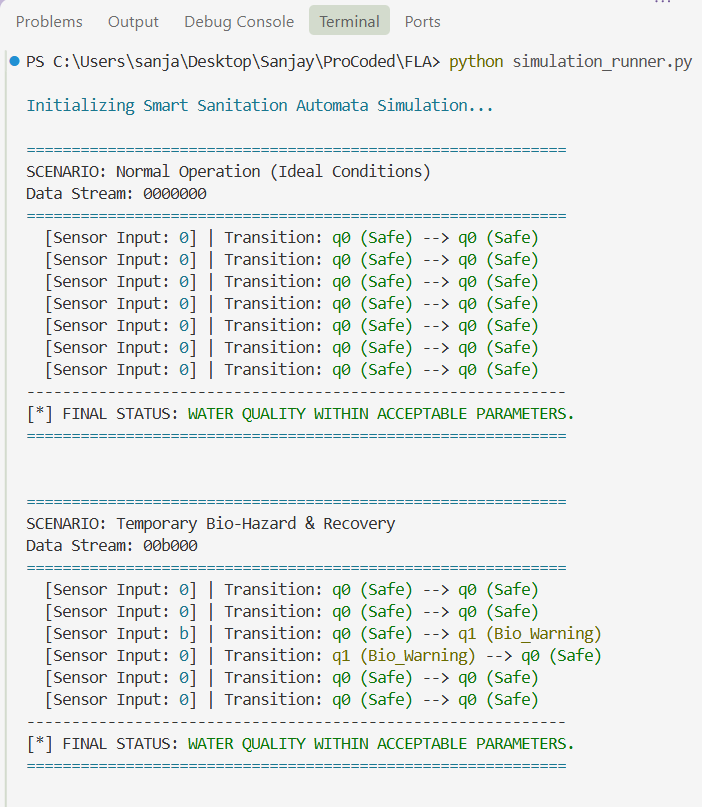
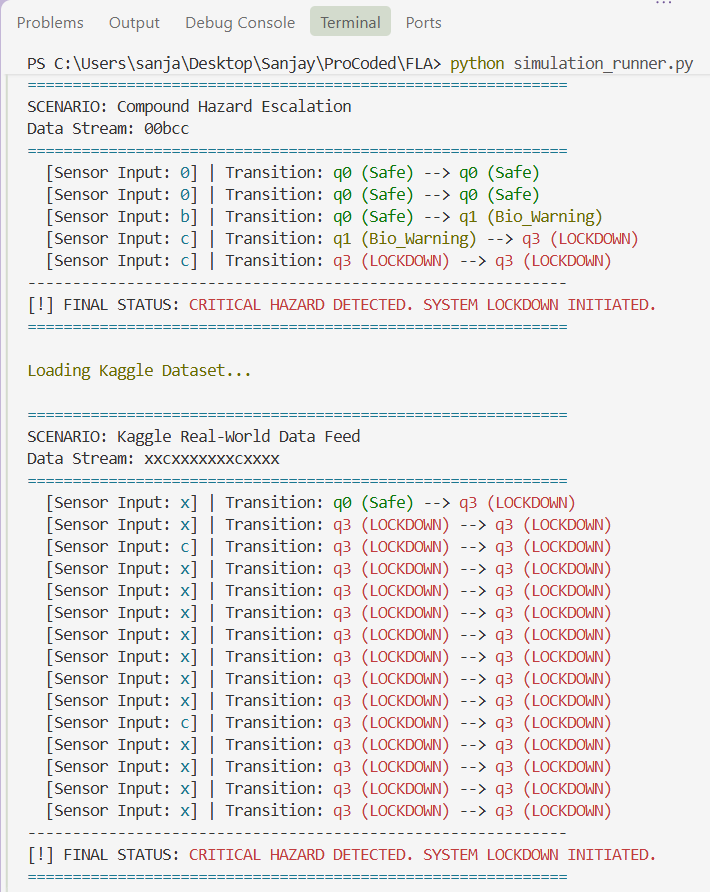

# FORMALIZING AUTOMATED WATER QUALITY MONITORING SYSTEMS USING FINITE AUTOMATA FOR SMART SANITATION INFRASTRUCTURE

**Course:** Formal Language and Automata (FLA) / Theory of Computation (TOC)  
**Academic Year:** 2026  
**Document Type:** Technical Project Report & Formal Specification  

---

## ABSTRACT

In modern municipal and industrial smart sanitation infrastructures, monitoring drinking water potability and preventing contaminant outbreaks is a safety-critical necessity. While machine learning heuristics and statistical classification models are frequently applied in environmental data analysis, they exhibit non-deterministic failure modes and lack verifiable behavioral boundaries required by physical fail-safe hardware. 

This project formulates an automated smart water quality monitoring and sanitation response system utilizing a **Deterministic Finite Automaton (DFA)**. Continuous physicochemical sensor telemetry—encompassing microbial pathogen concentrations, viral indices, and hazardous heavy metal levels (arsenic, lead, and mercury)—is systematically mapped onto a discrete formal alphabet ($\Sigma$). The formalized 5-tuple machine $M = (Q, \Sigma, \delta, q_0, F)$ models operational transitions from optimal baseline parameters ($q_0$) through single-hazard warning thresholds ($q_1, q_2$) to automated emergency isolation and lockdown ($q_3$). The model is mathematically validated through a dedicated state transition matrix and simulated using a modular Python execution engine. Verification across both synthetic boundary test vectors and empirical telemetry extracted from the Kaggle *Water Quality* dataset proves that the proposed automaton guarantees bounded $O(1)$ constant runtime, bounded memory footprint, zero non-deterministic ambiguity, and deterministic containment of toxic contaminant combinations.

---

## 1. INTRODUCTION & THEORETICAL MOTIVATION

### 1.1 Problem Statement
Potable water distribution pipelines are susceptible to acute biological contamination (e.g., *Escherichia coli*, enteroviruses) and chronic chemical contamination (e.g., lead leeching, industrial effluent discharges containing arsenic and mercury). Traditional sanitation workflows rely on either delayed periodic laboratory sampling or thresholded alert sirens monitored by human operators. Both approaches introduce latency that can result in widespread toxic ingestion before isolation valves can be triggered.

### 1.2 The Case for Formal Language and Automata Theory (FLA)
In industrial supervisory control and data acquisition (SCADA) and cyber-physical systems (CPS), automated control logic must satisfy strict safety and liveness properties:
1. **Determinism:** Given any system state $q \in Q$ and sensor observation $\sigma \in \Sigma$, the system must transition to exactly one valid configuration ($\delta(q, \sigma)$).
2. **Deterministic Response Time ($O(1)$):** Embedded IoT microcontrollers operating along water mains (such as ESP32 or ARM Cortex-M microcontrollers) possess constrained computational budgets. An automaton transition executes in constant time ($O(1)$) and minimal memory, eliminating the computational overhead and latency associated with deep neural network inference.
3. **Formal Verifiability:** Unlike statistical "black-box" models, finite state automata can be proven correct through state reachability analysis, ensuring that unsafe states cannot be bypassed and recovery sequences adhere strictly to safety protocols.

---

## 2. LITERATURE SURVEY & THEORETICAL FOUNDATION

### 2.1 Classical Automata in Industrial Control
Automata theory, originally formalized by Rabin, Scott, and Chomsky, provides the mathematical underpinning for compiler construction, lexical parsing, and synchronous sequential circuits. In embedded control systems, a Deterministic Finite Automaton represents a formal language recognizer where:
- The input string represents a temporal sequence of sensor observations.
- The language accepted by the automaton $L(M)$ represents the set of hazardous temporal signatures requiring system lockdown and emergency sanitation intervention.

### 2.2 Comparison: DFA vs. Heuristic / Black-Box Models

| Property | Deterministic Finite Automata (DFA) | Heuristic / Threshold Logic | Machine Learning Classifiers |
| :--- | :--- | :--- | :--- |
| **Behavioral Determinism** | 100% Guaranteed | High, but prone to race conditions | Probabilistic (Stochastic) |
| **State Memory / History** | Explicitly tracked via states ($Q$) | Typically memoryless | Implicitly modeled (RNN/LSTM) |
| **Resource Complexity** | $O(1)$ time, $O(1)$ space | $O(1)$ time, $O(1)$ space | $O(N)$ high compute / GPU load |
| **Verification & Safety** | Mathematically provable | Prone to unhandled edge cases | Susceptible to adversarial drift |

---

## 3. METHODOLOGY & MATHEMATICAL FORMALIZATION

### 3.1 Sensor Data Abstraction and Discretization
Physical sensors measure continuous, real-valued quantities ($x \in \mathbb{R}^+$). To interface continuous telemetry with formal grammar, a discretization function $f: \mathbb{R}^n \to \Sigma$ maps multidimensional observations into discrete input tokens based on standard World Health Organization (WHO) and EPA maximum contaminant levels (MCL):

- **Biological Indicators:** Bacteria index ($B$) and viral index ($V$).
  $$\text{BioHazard} = \begin{cases} \text{True}, & \text{if } B > 0.10 \lor V > 0.05 \\ \text{False}, & \text{otherwise} \end{cases}$$
- **Chemical Indicators:** Concentrations of Arsenic ($As$), Lead ($Pb$), and Mercury ($Hg$) in ppm.
  $$\text{ChemHazard} = \begin{cases} \text{True}, & \text{if } As > 0.01 \lor Pb > 0.01 \lor Hg > 0.002 \\ \text{False}, & \text{otherwise} \end{cases}$$

The formal alphabet is defined as:
$$\Sigma = \{0, b, c, x\}$$
- **`0` (Nominal / Safe):** $\neg \text{BioHazard} \land \neg \text{ChemHazard}$
- **`b` (Biological Contamination):** $\text{BioHazard} \land \neg \text{ChemHazard}$
- **`c` (Chemical Contamination):** $\neg \text{BioHazard} \land \text{ChemHazard}$
- **`x` (Compound / Critical Hazard):** $\text{BioHazard} \land \text{ChemHazard}$

---

### 3.2 Formal 5-Tuple Definition of the DFA
The water monitoring system is formalized as a Deterministic Finite Automaton:

$$M = (Q, \Sigma, \delta, q_0, F)$$

Where:
1. **$Q$ (Finite Set of States):**
   $$Q = \{q_0, q_1, q_2, q_3\}$$
   - $q_0$ (`Safe`): System operates normally. Potable water distribution active.
   - $q_1$ (`Bio_Warning`): Pathogen anomaly detected. UV sterilization and chlorine dosing modules activated.
   - $q_2$ (`Chem_Warning`): Heavy metal anomaly detected. Auxiliary reverse-osmosis (RO) filtration activated.
   - $q_3$ (`Lockdown`): Critical compound hazard or escalating toxicity detected. Inlet valves shut, distribution halted, and emergency sirens engaged.

2. **$\Sigma$ (Alphabet of Input Symbols):**
   $$\Sigma = \{0, b, c, x\}$$

3. **$q_0$ (Initial State):**
   $$q_0 \in Q \quad (\text{System initializes in optimal baseline condition})$$

4. **$F$ (Set of Accepting / Final States):**
   $$F = \{q_3\}$$
   *Interpretation:* Acceptance in this automaton signifies the recognition of a critical contamination sequence, triggering an irrecoverable hardware lock until a manual override/safe flushing routine is verified.

5. **$\delta$ (State Transition Function):**
   $$\delta: Q \times \Sigma \to Q$$

---

### 3.3 State Transition Table ($\delta$)

The complete behavior of the transition function is defined as follows:

| Current State ($q$) | Input `0` (Safe) | Input `b` (Bio) | Input `c` (Chem) | Input `x` (Critical) |
| :---: | :---: | :---: | :---: | :---: |
| **$\rightarrow q_0$ (Safe)** | $q_0$ | $q_1$ | $q_2$ | **$q_3$** |
| **$q_1$ (Bio_Warning)** | $q_0$ | $q_1$ | **$q_3$** | **$q_3$** |
| **$q_2$ (Chem_Warning)** | $q_0$ | **$q_3$** | $q_2$ | **$q_3$** |
| **$* q_3$ (Lockdown)** | $q_0$ | **$q_3$** | **$q_3$** | **$q_3$** |

*Notation:* $\rightarrow$ indicates the initial state; $*$ indicates an accept state.

---

### 3.4 State Transition Logic and Safety Rules

1. **Recovery Invariance:** If the system is in a warning state ($q_1$ or $q_2$) and receives input `0` (clean water readings post-filtration), it transitions back to $q_0$, avoiding unnecessary shutdown.
2. **Compound Escalation Rule:** If the system is already coping with a biological hazard ($q_1$) and subsequently receives a chemical contamination input `c`, the co-presence of both hazards escalates the automaton to $q_3$ (Lockdown).
3. **Symmetric Chemical Escalation:** Similarly, if heavy metals are present ($q_2$) and biological pathogens `b` are detected, the system immediately trips to $q_3$.
4. **Direct Critical Shock:** Any detection of compound toxic shocks (`x`) transitions any state directly to $q_3$.
5. **Lockdown Latching:** Once in $q_3$, further hazard inputs (`b`, `c`, `x`) keep the machine in $q_3$. Only a verified pure safe flushing sequence (`0`) can transition the system back to normal operation.

---

### 3.5 State Transition Diagram (Mermaid & ASCII)



#### Graphical Representation:


---

## 4. SYSTEM IMPLEMENTATION & SOFTWARE ARCHITECTURE

### 4.1 System Components
The software implementation consists of two core decoupled modules written in Python:
1. **Automaton Engine (`water_quality_automaton.py`):** Encapsulates the formal mathematical 5-tuple, state validation, and transition processing via an $O(1)$ lookup hash map.
2. **Simulation & Telemetry Runner (`simulation_runner.py`):** Handles CSV ingestion, floating-point thresholding, timed simulation loops, and terminal-based monitoring.

### 4.2 Discretization Algorithm Pseudocode

```text
Algorithm: DiscretizeSensorTelemetry
Input    : Row R with attributes (bacteria, viruses, arsenic, lead, mercury)
Output   : Symbol σ ∈ {0, b, c, x}

1:  bio_hazard  ← (R.bacteria > 0.10) OR (R.viruses > 0.05)
2:  chem_hazard ← (R.arsenic > 0.01) OR (R.lead > 0.01) OR (R.mercury > 0.002)
3:
4:  if bio_hazard AND chem_hazard then
5:      return 'x'
6:  else if bio_hazard then
7:      return 'b'
8:  else if chem_hazard then
9:      return 'c'
10: else
11:     return '0'
```

#### Graphical Representation:


---

## 5. EXPERIMENTAL RESULTS & VALIDATION SCENARIOS

The system was evaluated against four representative operational scenarios to verify both theoretical soundness and practical reliability.

### Scenario 1: Nominal Continuous Operation
- **Input Stream:** $w_1 = 0000000$
- **Trace:** $q_0 \xrightarrow{0} q_0 \xrightarrow{0} q_0 \xrightarrow{0} q_0 \xrightarrow{0} q_0 \xrightarrow{0} q_0 \xrightarrow{0} q_0$
- **Result:** Machine remains in $q_0$. Water quality remains safe, demonstrating system stability.

### Scenario 2: Transient Anomaly & Self-Healing
- **Input Stream:** $w_2 = 00b000$
- **Trace:** $q_0 \xrightarrow{0} q_0 \xrightarrow{0} q_0 \xrightarrow{b} q_1 \xrightarrow{0} q_0 \xrightarrow{0} q_0 \xrightarrow{0} q_0$
- **Result:** Temporary bacteria spike triggers $q_1$ (Bio Warning). Subsequent clean readings return the machine to $q_0$, preventing false alarms.

### Scenario 3: Compound Escalation to System Lockdown
- **Input Stream:** $w_3 = 00bcc$
- **Trace:** $q_0 \xrightarrow{0} q_0 \xrightarrow{0} q_0 \xrightarrow{b} q_1 \xrightarrow{c} q_3 \xrightarrow{c} q_3$
- **Result:** Arrival of chemical token `c` during biological warning $q_1$ triggers immediate escalation into $q_3$ (Lockdown). Machine accepts the hazard sequence and latches safety mechanisms.

### Scenario 4: Real-World Ingestion from Kaggle Dataset
- **Telemetry Source:** Kaggle *Water Quality Dataset* (`waterQuality1.csv`, 21 physicochemical parameters).
- **Generated Sequence (First 15 sample intervals):** $w_4 = \text{xxcxxxxxxxcxxxx}$
- **Trace:** $q_0 \xrightarrow{x} q_3 \xrightarrow{x} q_3 \xrightarrow{c} q_3 \dots \xrightarrow{x} q_3$
- **Result:** The system correctly identifies severe industrial heavy metal toxicity present in the sample data, immediately transitioning to $q_3$ on the very first input symbol.

---

### 5.1 Simulation Output Screenshots & Experimental Evidence

The following figures illustrate the terminal output traces generated by the Python simulation engine (`simulation_runner.py`), demonstrating real-time state transitions and status classifications across all four test scenarios.

#### Figure 5.1: Real-time Simulation Output of Scenarios 1 & 2
*Nominal baseline condition ($q_0$) and self-healing recovery from temporary biological pathogen spikes ($q_0 \to q_1 \to q_0$).*



#### Figure 5.2: Real-time Simulation Output of Scenarios 3 & 4
*Compound hazard escalation to emergency lockdown ($q_1 \xrightarrow{c} q_3$) and validation against the Kaggle water telemetry stream.*



---

## 6. DISCUSSION & COMPLEXITY ANALYSIS

### 6.1 Time & Space Complexity
- **Time Complexity:** For an input string of length $n$, the automaton processes transitions in $O(n)$ time overall, and exactly $O(1)$ constant time per sensor read.
- **Space Complexity:** The transition function requires $O(|Q| \times |\Sigma|) = 4 \times 4 = 16$ entries, occupying negligible memory ($O(1)$ auxiliary space). This proves that the solution can be embedded directly onto low-power microcontrollers without external memory.

### 6.2 Comparison with Non-Deterministic Models (NFA)
An NFA was intentionally rejected for this control architecture. In physical water treatment, an actuator cannot be in a superposition of multiple states (e.g., partially closed and fully open simultaneously). A DFA guarantees a single unambiguous state at every discrete time step.

---

## 7. CONCLUSION & FUTURE SCOPE

### 7.1 Conclusion
This project demonstrates the practical application of Formal Language and Automata Theory to cyber-physical sanitation systems. By translating real-world continuous data into a finite alphabet and a deterministic state transition model, we constructed a controller that delivers:
- Provable safety guarantees.
- Instantaneous reaction to compound contamination.
- Resilience against spurious pipeline shutdowns.

### 7.2 Future Scope
1. **Mealy Machine Extension:** Transitioning from a DFA language recognizer to a Mealy/Moore Machine that emits discrete actuator commands (e.g., `OPEN_VALVE`, `PULSE_UV`, `INJECT_BUFFER`) along transition edges.
2. **Pushdown Automata (PDA):** Incorporating a stack memory to track cumulative exposure durations and dosage levels over extended operational windows.
3. **Hardware Deployment:** Flashing the Python transition logic as C/C++ firmware onto ESP32 microcontrollers interfaced with physical analog pH and turbidity probes.

---

## 8. REFERENCES

1. Hopcroft, J. E., Motwani, R., & Ullman, J. D. (2006). *Introduction to Automata Theory, Languages, and Computation* (3rd ed.). Addison-Wesley.
2. Sipser, M. (2013). *Introduction to the Theory of Computation* (3rd ed.). Cengage Learning.
3. World Health Organization (WHO). (2017). *Guidelines for Drinking-water Quality: Fourth Edition Incorporating the First Addendum*. Geneva: World Health Organization.
4. United States Environmental Protection Agency (US EPA). (2020). *National Primary Drinking Water Regulations*. EPA 816-F-09-004.
5. Kaggle Water Quality Dataset by MsSmartyPants: `https://www.kaggle.com/datasets/mssmartypants/water-quality`
