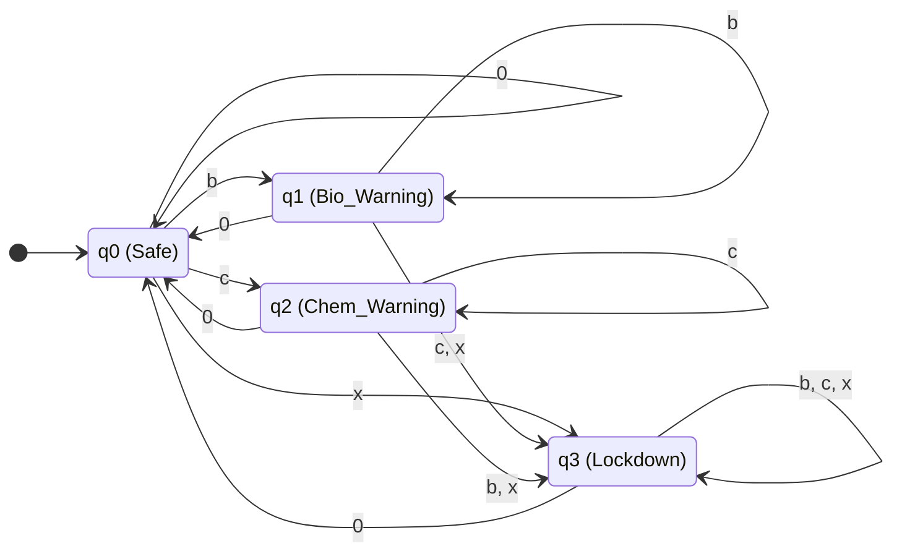

# Formal Specification & Diagramming

## 1. The 5-Tuple Definition

A Deterministic Finite Automaton (DFA) is formally defined as a 5-tuple: **$M = (Q, \Sigma, \delta, q_0, F)$**

For our Smart Water Quality Monitoring System, the 5-tuple is defined as follows:

*   **$Q$ (Finite Set of States):** $\{q_0, q_1, q_2, q_3\}$
    *   $q_0$: `Safe` (Water quality is optimal)
    *   $q_1$: `Bio_Warning` (Biological contamination detected; e.g., high bacteria)
    *   $q_2$: `Chem_Warning` (Chemical contamination detected; e.g., high lead/arsenic)
    *   $q_3$: `Lockdown` (Critical state requiring automated system shutdown)

*   **$\Sigma$ (Alphabet):** $\{0, b, c, x\}$
    *   `0`: No hazards present (safe readings).
    *   `b`: Biological hazard threshold exceeded.
    *   `c`: Chemical hazard threshold exceeded.
    *   `x`: Extreme hazard (Both Biological and Chemical thresholds exceeded).

*   **$q_0$ (Start State):** $q_0$ (The system initializes assuming the water is safe).

*   **$F$ (Set of Accept States):** $\{q_3\}$ (Reaching this state "accepts" the hazard string, triggering the ultimate safety protocol).

*   **$\delta$ (Transition Function):** Defined by the mapping $Q \times \Sigma \rightarrow Q$.

---

## 2. State Transition Table ($\delta$)

This table maps out exactly how the system reacts to every possible sensor reading at any given state.

| Current State ($q \in Q$) | Input `0` (Safe) | Input `b` (Bio) | Input `c` (Chem) | Input `x` (Extreme) |
| :--- | :--- | :--- | :--- | :--- |
| **$\rightarrow q_0$ (Safe)** | $q_0$ | $q_1$ | $q_2$ | **$q_3$** |
| **$q_1$ (Bio_Warning)** | $q_0$ | $q_1$ | **$q_3$** | **$q_3$** |
| **$q_2$ (Chem_Warning)** | $q_0$ | **$q_3$** | $q_2$ | **$q_3$** |
| **$* q_3$ (Lockdown)** | $q_0$ | **$q_3$** | **$q_3$** | **$q_3$** |

*(Note: $\rightarrow$ denotes the start state, and $*$ denotes an accept state.)*

### Logic Rules:
1.  **Recovery:** If the system is in a warning state ($q_1$ or $q_2$) or even a lockdown ($q_3$), reading a clean input (`0`) flushes the system back to safe ($q_0$).
2.  **Compounding Hazards:** If the system already has a biological warning ($q_1$) and suddenly detects a chemical hazard (`c`), it instantly escalates to a lockdown ($q_3$).

---

## 3. State Transition Diagram

Here is the visual representation of our Automaton. You can render this diagram using Mermaid (supported by GitHub, Notion, and most Markdown readers).

