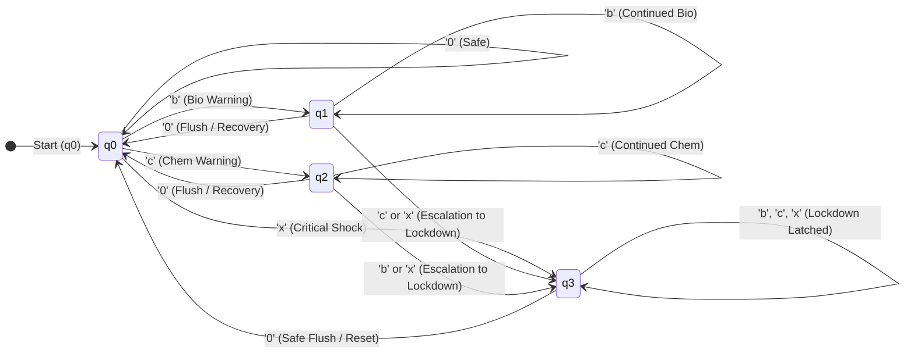
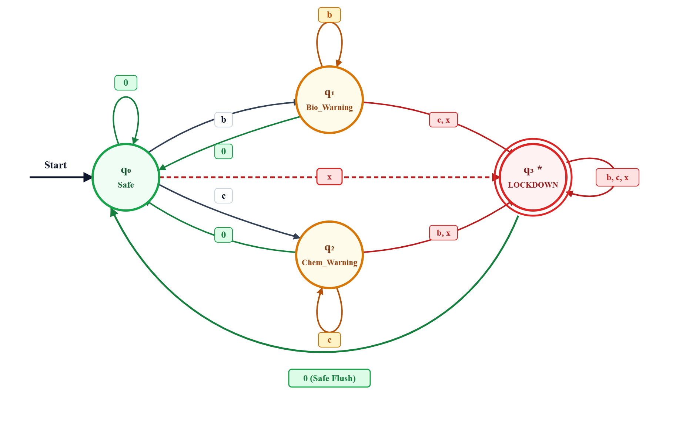

# 🌊 Formalizing Automated Water Quality Monitoring Systems Using Finite Automata

A Formal Language and Automata (FLA) project modeling a smart sanitation monitoring infrastructure. The system formalizes sensory water quality evaluations using a **Deterministic Finite Automaton (DFA)** to enforce automated responses, warning escalations, and system lockdowns against biochemical hazards.

---

## 📌 Project Overview

Continuous water quality assessment is critical for municipal and industrial sanitation pipelines. Rather than using purely heuristic or machine learning approaches that lack mathematical determinism, this project uses **Formal Language and Automata Theory** to:
1. Discretize continuous physical and chemical sensor data into a well-defined formal alphabet ($\Sigma$).
2. Transition across discrete operational states ($Q$) using a deterministic state transition function ($\delta$).
3. Identify hazardous contamination patterns and trigger emergency safety protocols when entering accept/critical states ($F$).

---

## ⚙️ Formal Definition (5-Tuple)

The core monitoring engine is modeled as a DFA:

$$M = (Q, \Sigma, \delta, q_0, F)$$

- **$Q$ (States):** $\{q_0, q_1, q_2, q_3\}$
  - $q_0$: `Safe` — Water quality parameters are within safe WHO thresholds.
  - $q_1$: `Bio_Warning` — Biological contamination detected (e.g., elevated bacteria/viruses).
  - $q_2$: `Chem_Warning` — Chemical contamination detected (e.g., toxic heavy metals).
  - $q_3$: `Lockdown` — Critical hazard state requiring system shutdown and alarm.
- **$\Sigma$ (Alphabet):** $\{0, b, c, x\}$
  - `0`: Normal / Safe reading.
  - `b`: Biological threshold exceeded.
  - `c`: Chemical threshold exceeded.
  - `x`: Compound hazard (both biological and chemical thresholds breached).
- **$q_0$ (Start State):** Initial state assuming baseline safe water.
- **$F$ (Accepting / Final States):** $\{q_3\}$ (Entering lockdown accepts the hazard sequence and triggers emergency response).
- **$\delta$ (Transition Function):** Governs operational responses and compound hazard escalations.

### State Transition Table

| Current State ($q \in Q$) | Input `0` (Safe) | Input `b` (Bio) | Input `c` (Chem) | Input `x` (Critical) |
| :--- | :--- | :--- | :--- | :--- |
| **$\rightarrow q_0$ (Safe)** | $q_0$ | $q_1$ | $q_2$ | **$q_3$** |
| **$q_1$ (Bio_Warning)** | $q_0$ | $q_1$ | **$q_3$** | **$q_3$** |
| **$q_2$ (Chem_Warning)** | $q_0$ | **$q_3$** | $q_2$ | **$q_3$** |
| **$* q_3$ (Lockdown)** | $q_0$ | **$q_3$** | **$q_3$** | **$q_3$** |

---

## 🗺️ State Transition Diagram



<div align="center">
  
  <p><em>Figure 1: Deterministic Finite Automaton (DFA) State Transition Architecture for Smart Sanitation Monitoring.</em></p>
</div>

---

## 🚀 Getting Started

### Prerequisites

- Python 3.8+
- Standard Python libraries (`csv`, `time`, `sys`) — no third-party package dependencies required.

### Installation & Execution

1. Clone or navigate to the repository directory:
   ```bash
   cd c:\Users\sanja\Desktop\Sanjay\ProCoded\FLA
   ```

2. Run the real-time simulation test suite:
   ```bash
   python simulation_runner.py
   ```

3. Alternatively, use the standalone automaton module directly:
   ```bash
   python water_quality_automaton.py
   ```

---

## 🧪 Simulation Scenarios

The runner executes 4 key operational scenarios:
1. **Normal Operation:** Tests safe strings (`0000000`) keeping the system in $q_0$.
2. **Temporary Bio-Hazard & Recovery:** Tests transient biological anomalies (`00b000`) demonstrating recovery back to safe state upon flush.
3. **Compound Hazard Escalation:** Demonstrates escalation from $q_1$ to $q_3$ when a chemical hazard strikes during an active biological warning (`00bcc`).
4. **Real-World Kaggle Dataset Feed:** Discretizes actual physicochemical readings from `waterQuality1.csv` and tests the automaton against real water samples.

---

## 📂 Repository Structure

- [`water_quality_automaton.py`](water_quality_automaton.py) — Core DFA implementation (`WaterQualityDFA`) and data discretization logic.
- [`simulation_runner.py`](simulation_runner.py) — Interactive CLI test suite with colored state transition displays.
- [`waterQuality1.csv`](waterQuality1.csv) — Kaggle water quality dataset with 21 physicochemical attributes.
- [`Final_Project_Report.md`](Final_Project_Report.md) — Comprehensive academic report detailing theory, math, and findings.
- [`Phase2_Formal_Specification.md`](Phase2_Formal_Specification.md) — Mathematical specification document.
- [`ARCHITECTURE.md`](ARCHITECTURE.md) — System architecture, pipeline design, and state machine diagrams.
- [`PROJECT_CONTEXT.md`](PROJECT_CONTEXT.md) — Academic context, theoretical justification, and background notes.
